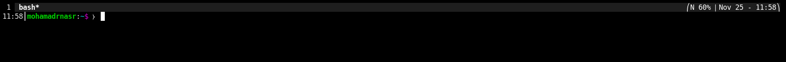

# Tmux Configuration

A personal customized Tmux setup with a minimal status bar, improved shell prompt, custom colors, and useful keyboard shortcuts.

## Preview



## Setup

```bash
mkdir -p ~/.config/tmux/
git clone https://github.com/mohamadrnasr/tmux-config.git "$HOME/.config/tmux"
```
Close and reopen Tmux to apply the configuration.


## Dependencies

The following tools are required:

- **LazyGit** – For Git integration inside Tmux.
- **Clipboard utility** – Depends on your desktop environment:
  - `wl-copy` – Wayland (default configuration).
  - `xclip` or `xsel` – X11.
  - `pbcopy` – macOS.

### Clipboard Configuration

If you are using a different clipboard utility, update the following line in `tmux.conf`:

```bash
bind-key -T copy-mode M-w send -X copy-pipe-and-cancel "wl-copy"
```

Replace `wl-copy` with the appropriate command:

| Environment | Command |
|---|---|
| Wayland | `wl-copy` |
| X11 | `xclip -selection clipboard` |
| X11 | `xsel --clipboard --input` |
| macOS | `pbcopy` |

## Features

- Custom color scheme and pane borders.
- Status bar moved to the top.
- Custom shell prompt with username, current directory, and time.
- LazyGit integration through a popup (`Ctrl + G`).
- Terminal popup in the current pane's directory (`Ctrl + P`).
- Clipboard integration (`Alt + W` in copy mode).
- 24-hour clock mode.

